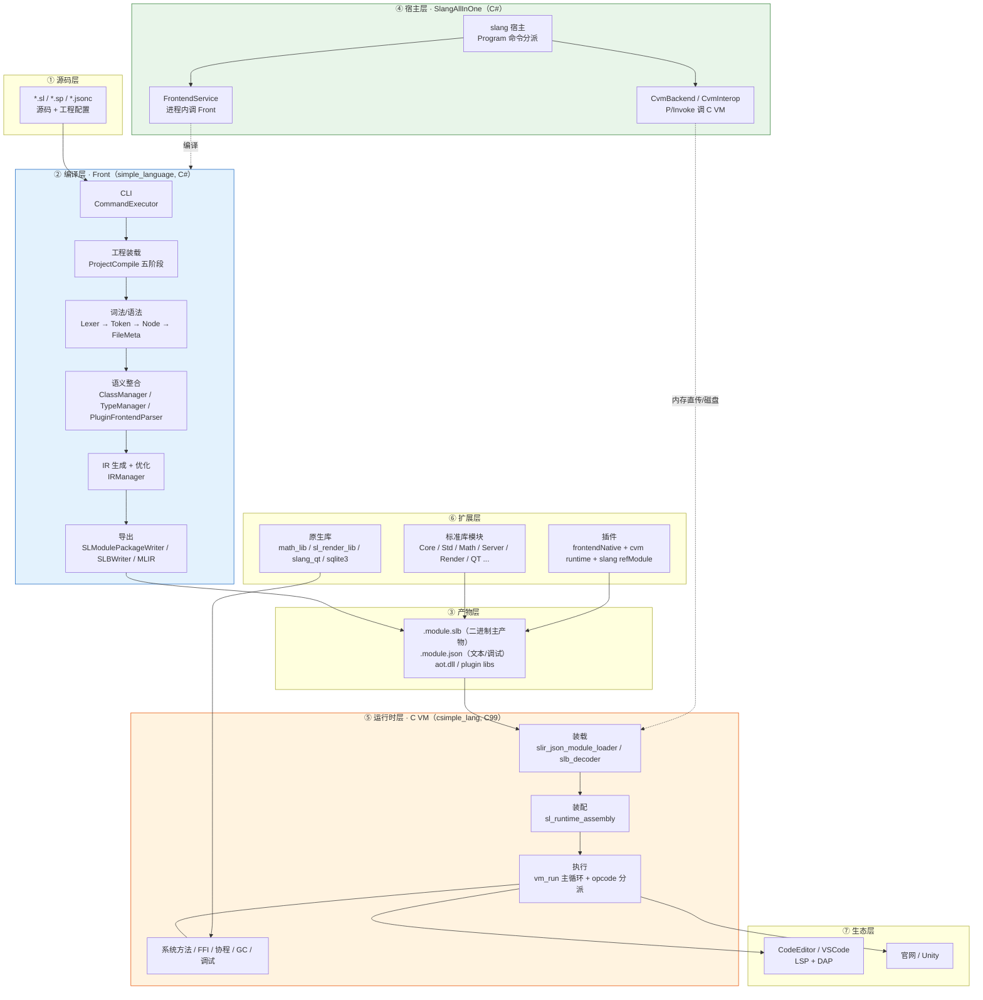
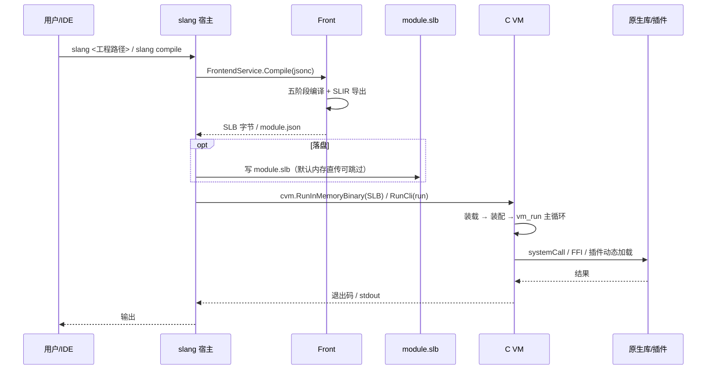

# SLang 系统总揽

> 本文档是 `doc/system/` 系统架构文档集的入口，从「工程地图 + 分层视图 + 数据主干」三个角度俯瞰整个 SLang 工程。
> 基线：本体版本 `0.0.68`（Front / C VM / 宿主），2026-11-17 整理。
> 姊妹文档：[01-全链路流程](01-全链路流程.md) · [02-虚拟机生命周期](02-虚拟机生命周期.md) · [09-索引](09-文档索引.md)

---

## 1. 一句话概括

SLang 是一个「**自研编译器前端（C#）+ 自研虚拟机（C99）+ 统一宿主（C#）**」三段式语言运行时：

```
.sl/.sp 源码 ──Front 编译──► module.slb / module.json ──C VM 装载执行──► 程序结果
                                    ▲                        ▲
                              标准库 / 模块               FFI / 插件 / 原生库
```

- **Front**（`simple_language`）：把源码编译成 SLIR 包（`.module.slb` / `.module.json`）。
- **Runtime**（`csimple_lang`）：装载 SLIR 包、装配符号、执行指令的 C99 虚拟机。
- **宿主**（`SlangAllInOne`）：把两者粘合成的 `slang` 命令，同时承载标准库、测试、工具、发布。

---

## 2. 全仓工程地图

按「主体三件套 → 扩展 → 附属生态」分层。带 ★ 为核心链路。

| 层 | 工程 / 目录 | 角色 | 技术栈 |
|----|------------|------|--------|
| ★主体 | `simple_language/` | Front 编译器（语义真源） | C# / .NET 8 |
| ★主体 | `csimple_lang/` | C VM（exe + P/Invoke dll） | C99 / CMake + MSVC |
| ★主体 | `SlangAllInOne/` | 宿主 slang + 标准库 + 测试 + 工具 + 文档 | C# / .NET 8 |
| 扩展 | `plugin/` | 7 个语言/运行时插件（csharp_mono、java_hotspot、cplus_clang、python_cpython、javascript_quickjs、typescript_nodev8、echo） | C/C++ + 少量 C# |
| 附属 | `SLangCodeEditor/` | SL 编写的多标签 IDE（消费 QT 标准库模块） | SL / SLangQT |
| 附属 | `slang_vscode_plugin/` | VS Code 插件（LSP / DAP 消费方，未接入主构建） | TypeScript |
| 附属 | `SlangAllInOne/unity/` | Unity3D 集成实例（HelloCube，UPM 包） | C++ + SL |
| 附属 | `SLangOfficialWebsite/` | 官网与后管（独立运行） | Astro/Vue + C# |

> 完整 sln 工程清单（构建视角）见 [08-工具链与打包发布](08-工具链与打包发布.md) §1；权威路径记忆见仓库根 `PROJECTS.md`。

---

## 3. 分层架构总揽图



**读图要点**

1. 蓝色（编译层）/ 绿色（宿主层）/ 橙色（运行时层）是主链路三段。
2. 标准库与插件的产物同样汇入「产物层」，再统一被 C VM 装载。
3. 宿主 `slang` 有两条手臂：左臂 `FrontendService` 调 Front 编译，右臂 `CvmBackend` 调 C VM 执行；「裸工程路径编译即运行」即两条手臂串起来的结果。
4. 原生库（FFI/插件运行体）在执行期由 C VM 的 `SYS` 子系统加载。

---

## 4. 数据主干（端到端时序概览）



更细的逐步流程见 [01-全链路流程](01-全链路流程.md)；VM 内部装载→装配→执行的完整生命周期见 [02-虚拟机生命周期](02-虚拟机生命周期.md)。

---

## 5. 关键路径速查

| 语义 | 路径 |
|------|------|
| Front 源码 | `d:/project/lang/simple_language/source/` |
| C VM 源码 | `d:/project/lang/csimple_lang/src/` |
| 宿主源码 | `d:/project/lang/SlangAllInOne/`（`Program.cs` + `FrontEnd/` + `Backend/` …） |
| 标准库源码 | `d:/project/lang/SlangAllInOne/SLangCore/Lib/` |
| 测试用例 | `d:/project/lang/SlangAllInOne/SLangCore/test/` |
| 插件根 | `d:/project/lang/plugin/` |
| 全仓产物根 | `d:/project/lang/SlangAllInOne/out/export/` |
| 发布包根 | `d:/project/lang/SlangAllInOne/package/{win32,linux}-{debug,release}/` |
| 权威工程清单 | `d:/project/lang/SlangAllInOne/PROJECTS.md` |

---

## 6. 阅读路线建议

- 想看「一段代码怎么变成可执行」→ [01-全链路流程](01-全链路流程.md)
- 想看「虚拟机从启动到退出经历什么」→ [02-虚拟机生命周期](02-虚拟机生命周期.md)
- 想深入某个子系统 → [03-Front 编译器](03-Front编译器.md) ~ [08-工具链与打包发布](08-工具链与打包发布.md)
- 想查某个命令/路径 → [09-文档索引](09-文档索引.md)
