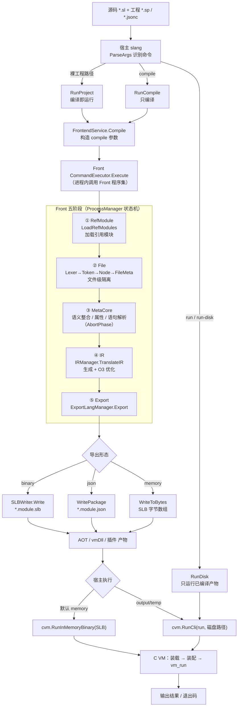
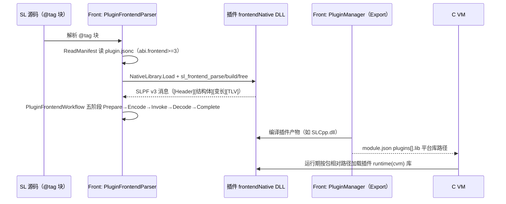

# SLang 全链路流程：从 Front 到 Runtime

> 本文档描述一段 SL 源码从「输入 Front 编译」到「C VM 执行出结果」的完整流程，覆盖 Front 五阶段、导出子步骤、宿主编排、插件/模块参与点。
> 与 [02-虚拟机生命周期](02-虚拟机生命周期.md) 的分工：本文聚焦 **Front 编译 + 跨进程衔接**，02 聚焦 **C VM 进程内部**。

---

## 1. 流程全景



---

## 2. Front 五阶段详解

编译总入口：`CommandExecutor.ExecuteCompile`（`simple_language/source/CLI/CommandExecutor.cs`）
→ `ProjectManager.Run` → `ProjectCompile.Compile`（`Project/ProjectCompile.cs`）。
阶段顺序由 `Process/ProcessManager.cs` 定义：`RefModule → File → MetaCore → IR → Export`；
步骤注册集中在 `ProjectCompile.InitCompileProcess()`（`Project/ProjectCompile.cs`）。

### 阶段 ① RefModule — 读取引用模块
- 步骤 `LoadRefModules` → `ProjectReferenceModuleLoader.LoadReferences(config, projectPath)`（`Project/ProjectReferenceModuleLoader.cs`）。
- 先经 `ProjectModuleDependency.EnsureModuleReferences` 做 spm 依赖检查/下载，再按路径加载 `.module.json` / `.slb`。
- 引用包直接构建 `IRMetaClass/IRMethod/IRMetaVariable`（`isRefModulePreBuilt`），不经 Meta 重建。
- 错误策略：`NotifyOnly`（只提示，不中断）。

### 阶段 ② File — 文件级隔离（Token → Node → FileMeta）
- `FileParse.ParseTokenStep` / `ParseNodeStep` / `ParseFileStep`（`Parse/FileParse.cs`）。
  - `LexerParse.ParseToTokenList`（`Parse/LexerParseToToken.cs`）：字符流 → Token 列表。
  - `TokenParse.BuildStruct`（`Parse/TokenParseToNode.cs`）：Token → Node 结构树。
  - `StructParse.ParseRootNodeToFileMeta`（`Parse/StructParseFrame.cs`）：Node → 单文件 FileMeta。
- 每文件独立隔离，`compileFiles.files[].ignore` 的文件不创建 FileParse（LSP 灰区来源）。

### 阶段 ③ MetaCore — 语义整合（`AbortPhase`，错误即中断）
步骤链（`ProjectCompile.cs`）：

```
ExpandBind → InjectDllImportHolder → CreateNamespace → CombineFileMeta
→ CheckReferenceCycles → ParseMetaClassLink → ParseAttributes → ParseMemberExpress
→ CheckMemberNewCycles → InjectProjectData → ValidatePlatformConfig → BuildLocalClass
→ ParseStatements → InjectInitCall → AddGlobalData → ProjectCompileAfter → AutoInlineMark
```

- 关键管理者：`ClassManager` / `TypeManager` / `MethodManager` / `ImportManager`（`simple_language/source/Core/`）。
- 插件前端在属性/标签解析阶段介入（见 §6）。
- `AutoInlineMark`（`AutoInlineMarkFunctions`）：按 `-O` 级别自动标记 inline。

### 阶段 ④ IR — IR 生成与优化
- 步骤 `TranslateIR` → `IRManager.instance.TranslateIR()`（`IR/IRManager.cs`）：
  `ParseClass()` → `Parallel.ForEach` 逐函数 `TranslateIRByFunction` → `AddIRMethod` → `ParseIRMethod()` → `ExportIRDebugData()`。
- 优化：O3 常量融合、`TryFuseConstGlobalInitializer`、静态/实例字段融合（`IR/Core/IRMetaClass.cs`）。
- 产物之一 `IR.txt`（`export.debugText` 开启时）。

### 阶段 ⑤ Export — 导出（由 CLI 触发 `RunPhase(Export)`）
`ExportLangManager.Export(ExportKind.SLIR)`（`Export/ExportLangManager.cs`）依次：

| 子步骤 | 实现 | 产出 |
|--------|------|------|
| 1. MLIR AOT | `MLIRExportManager.Instance.Run`（`Export/MLIR/MLIRExportManager.cs`） | `aot.mlir` → `aot.dll`（失败回落 CVM），manifest 并入 module.json |
| 2. vmDll 构建 | `VmDllBuildManager.Run`（`Export/VmDllBuildManager.cs`） | MSBuild 编译 `vmDlls` 并拷贝 DLL |
| 3. 插件产物 | `PluginManager.Run`（`Export/PluginManager.cs`） | `@tag` 插件构建、`plugins[].lib` 平台库拷贝 |
| 4. 统一包构建 | `SLModulePackageWriter.Build`（`Export/SLIR/SLModulePackageWriter.cs`） | 内存 package 对象 |
| 5. 落盘/内存写出 | `SLBWriter.Write` / `WritePackage` / `WriteToBytes` | `.slb` / `.json` / 字节数组 |

**SLB 段布局**（`Export/SLIR/Binary/SLBFormat.cs`）：`POOL / META / NS / CLASS / GLOBAL / METHOD / CODE / IRSTRING / DEBUG` 九段，DEBUG 段由 `FlagDebugInfo`(bit2) 控制。

---

## 3. 宿主编排：编译即运行 vs 分离命令

宿主 `Program.cs`（`d:/project/lang/SlangAllInOne/Program.cs`）的关键分流：

```
ParseArgs
├─ 裸工程路径（非已知命令、非模块包文件） → Command = "projectrun" → RunProject
├─ compile        → RunCompile      → FrontendService.Compile
├─ run/run-disk   → RunDisk          → CvmBackend 只运行编译结果
├─ publish/test/project/new/lsp/pack-modules/version/ffi-check ...
```

**裸工程路径 = 编译即运行**（`RunProject`，`Program.cs`）：
1. `FrontendService.Compile`（`FrontEnd/FrontendService.cs`）构造 `compile -e ir -p ... --export-mode ...` 调 `CommandExecutor.Execute`。
2. `CvmBackend.Locate` 定位 C VM DLL。
3. 默认 `--export-mode memory`：`cvm.RunInMemoryBinary(PackageBytes, ...)`，**SLB 字节零落盘直传** C VM。
4. `--export-mode output|temp`：先落盘，再 `cvm.RunCli(["run", modulePath, ...])`。

> P/Invoke 真实导出只有 3 个宿主入口（在 `csimple_lang/src/cli/cli.h`，非 `cvm_*` 前缀）：
> `cli_main` / `cli_run_module_in_memory`（JSON 文本）/ `cli_run_module_in_memory_binary`（SLB 字节）。声明见 `SlangAllInOne/Backend/CvmInterop.cs`。

---

## 4. JSONC 配置在链路中的作用

配置模型 `ProjectConfig.cs`，解析 `ProjectJsoncLoader.cs`（均在 `simple_language/source/Project/`）。

| 字段 | 影响阶段 | 作用 |
|------|---------|------|
| `project` / `source` | 全程 | 工程名 / guid / 源码根 / 入口文件 |
| `compileFiles.files[]` / `compileFilter` | ② File | 参与编译的文件清单、分组、tag、ignore |
| `compile`（optimize/target/语法开关） | ③④ | 优化级别、平台、systemMethod/dollar 下标等开关 |
| `references[]` | ① RefModule / ⑤ Export | 引用模块（spm 下载）；导出时写为 `moduleReferences` |
| `global`（imports/replace/data/macro） | ③ MetaCore | 数据注入 Project 静态成员、宏供 `_before_()` |
| `dllImports[]` | ③/⑤ | FFI 别名解析、静态库绑定声明 |
| `vmDlls[]` | ⑤ Export / VM 装配 | VS 工程 MSBuild 编译+拷贝原生库 |
| `systemCalls[]` | VM 装配 | `cvmFunction` 非空则下沉 C VM 系统方法 |
| `plugins`（id/path/lib/abi/…） | ③/⑤ | 插件前端定位与产物打包 |
| `export`（moduleName/format/binary/aot…） | ⑤ Export | 产物名、三态格式、DEBUG 段开关 |
| `platform` / `publish` / `spm.registry` | 编译期校验 / 发布 | 平台条件 AST 校验、发布配置 |

---

## 5. 插件前端参与链路

插件让 SL 源码可 `@tag{}` 内联其它语言（C++/C#/Java/Python/JS/TS）。



- ABI 契约头：`plugin/cplus_clang/frontend/src/sl_frontend_abi.h`（SLPF v3，三导出 `sl_frontend_parse/build/free` + `sl_frontend_abi_version`）。
- 插件三工程：`frontend/`（原生前端）+ `cvm/`（runtime）+ `slang/`（refModule），产物统一导出 `package/`，布局见 [07-插件系统](07-插件系统.md)。

---

## 6. LSP / DAP 旁路流程

这两条不是「编译→执行」主链，而是编译链的旁路消费者：

- **LSP**：`slang lsp`（`Lsp/LspServer.cs`，防抖 400ms）→ spawn `slang lsp-compile`（`Lsp/LspCompileCommand.cs`）→ `FrontendService.Compile(..., Memory, format:json)` → `LspIRIndexExporter` 从 IR 指令流导出 `files/symbols/refs` 索引，经 stdout 结构化 JSON 返回。`index.excluded + ignoredFiles` 推给 VSCode 标记灰区。
- **DAP**：`slang run <module> --debug-server=<port>`（或裸工程 `--export-mode output|temp`）启动 C VM 的 **SLDP 调试服务器**（NDJSON over TCP），VSCode DAP 适配器连接。调试信息随 SLB DEBUG 段产出（`includeDebugInfo`）。注意 `--debug` 是 C VM verbose 跟踪，与 DAP 是不同通道。

---

## 7. 关键函数索引

| 环节 | 函数 | 文件（相对 `simple_language/source/` 除非注明） |
|------|------|------|
| 命令分发 | `CommandExecutor.Execute` | `CLI/CommandExecutor.cs` |
| 编译总控 | `ProjectCompile.Compile` / `InitCompileProcess` | `Project/ProjectCompile.cs` |
| 装载引用 | `ProjectReferenceModuleLoader.LoadReferences` | `Project/ProjectReferenceModuleLoader.cs` |
| 词法 | `LexerParse.ParseToTokenList` | `Parse/LexerParseToToken.cs` |
| 语法 | `TokenParse.BuildStruct` / `StructParse.ParseRootNodeToFileMeta` | `Parse/TokenParseToNode.cs` / `Parse/StructParseFrame.cs` |
| 语义 | `ClassManager` / `MethodManager.ParseStatements` | `Core/` |
| IR | `IRManager.TranslateIR` | `IR/IRManager.cs` |
| 导出 | `ExportLangManager.Export` | `Export/ExportLangManager.cs` |
| 包构建 | `SLModulePackageWriter.Build` | `Export/SLIR/SLModulePackageWriter.cs` |
| SLB 写 | `SLBWriter.Write` / `WriteToBytes` | `Export/SLIR/Binary/SLBWriter.cs` |
| 宿主编排 | `RunProject` / `RunCompile` / `RunDisk` | `SlangAllInOne/Program.cs` |
| Front 服务 | `FrontendService.Compile` | `SlangAllInOne/FrontEnd/FrontendService.cs`（宿主侧） |
| P/Invoke | `CvmInterop` | `SlangAllInOne/Backend/CvmInterop.cs`（宿主侧） |
