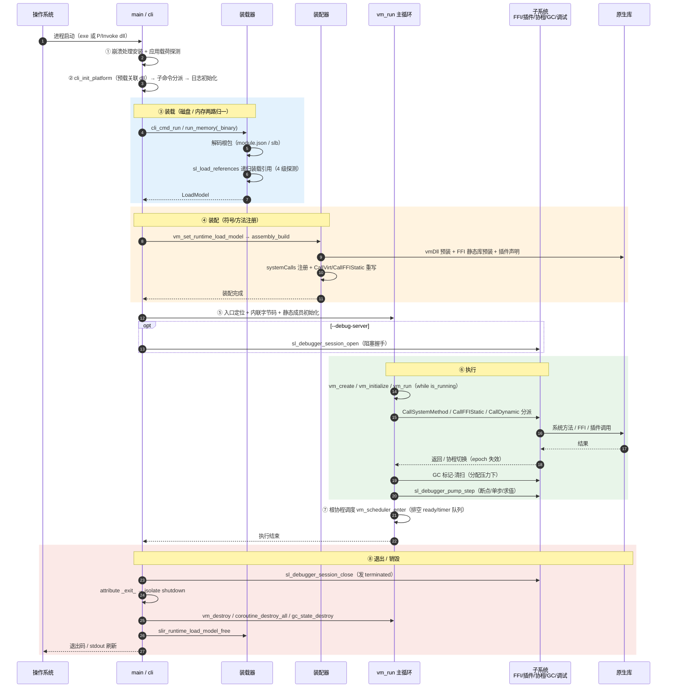

# C VM 虚拟机生命周期（时间序）

> 本文档以时间为轴，描述 C99 虚拟机（`csimple_lang`）从进程启动到退出的完整生命周期：装载 → 装配 → 执行 → 销毁。
> 所有阶段汇聚于一处：`run_vm_with_load_model`（`csimple_lang/src/cli/cli_command.c`）。
> 与 [01-全链路流程](01-全链路流程.md) 的分工：01 讲 Front 编译与跨进程衔接，本文聚焦 **C VM 进程内部**。

---

## 1. 生命周期时序总图

---

## 2. 各阶段详解（含代码锚点）

### ① 进程启动 — `main()`
- 入口：`src/main.c:7`。
- Windows 上先 `sl_crash_install()`（`src/lib/windows/sl_crash-win32.c`）。
- 检测尾部 `"SLVMAPP1"` 应用载荷（`cli/cli_app_payload.c`）：命中则 `cli_app_payload_run` 直接运行（双击 exe 形态），否则进 `cli_main()`。

### ② CLI 初始化 — `cli_main()` / `cli_main_impl()`
- `src/cli/cli.c:312` / `:416`。
- `cli_init_platform()`（`cli.c:55`）：内含 `sl_preload_associated_dlls()`（预载 `lib/<平台>/` 关联 dll，如 sqlite3 delay-load）+ 反调试门。
- 子命令分派 → `cli_init_log()`（`cli.c:75`）→ 运行入口：
  - `cli_cmd_run()`（`cli_command.c:671`，磁盘）
  - `cli_cmd_run_memory()`（`:747`，内存 JSON）
  - `cli_cmd_run_memory_binary()`（`:786`，内存 SLB 字节）

### ③ 装载 — SLIR 包与引用
- 解码：`vm/load/slb_decoder.c`（SLB 二进制）、`vm/load/slir_json_module_loader.c`（JSON，SLB 优先重定向）。
- `sl_load_references()`（`slir_json_module_loader.c:3040`）引用探测顺序：
  1. 绝对路径 / `D:` / 以 `\` `/` 开头 → 原样；否则 `<dir>/<引用>` → `sl_load_recursive()`。
  2. 失败回退：`basename` 去 `.module` → `<dir>/<basename>.module.json`。
  3. 官方库/spm 直查：`<dir>/modules` → `<exe>/modules` → `<exe>/lib`（`sl_exe_dir_join_name`），每处平铺 `名.slb|json` 与 `名/名.slb|json` 双探测。

### ④ 装配 — `sl_runtime_assembly_build_from_load_model()`
- 触发：`vm_set_runtime_load_model()`（`vm/runtime/vm_runtime.c:193`）→ 装配（`vm_runtime.c:217`）。
- 主装配器：`vm/assembly/sl_runtime_assembly.c`（约 79KB）。顺序：
  1. **vmDll 预装载**（`:1700-1730`）：`vmDllImports` → `vm_system_func_preload_ext_lib()`（`system_method_registry.c:230`）。
  2. **FFI 静态库预装载**（`:1732-1762`）：`dllImports[].static` → `vm_sys_ffi_static_lib_register()`（`ffi_system_method.c:777`）。
  3. **插件声明注册**（`:1764+`）。
  4. **systemCalls 注册**（`:899`）：`cvmFunction` → `vm_system_func_dynamic_register()`（`system_method_registry.c:703`），失败转插件 capability 注册。
  5. **指令重写**：`CallStatic(73)→CallFFIStatic(77)`（`vm/runtime/attribute/vm_runtime_attribute.c:594`）、`CallVirt` 绑定重写（`sl_runtime_assembly.c:1496`）。

> **三条外部函数通道**（assembly 阶段铺路，执行期生效）：
> 1. `systemCalls` 注册表：按 ID/名取函数指针直调；解析失败留 NULL 占位，调用期按 `cvm_function` 惰性重解析（`system_method_registry.c:721-753`）。
> 2. `vmDll` 预装载：LoadLibrary 进 ext-lib 缓存，使 `DllName!symbol` 形式可解析。
> 3. `FFI`：`@DllStaticImport` → `CallFFIStatic` 静态绑定表直调；`@DllImport` 走 `SystemFFICall* → sl_ffi_call()`（`lib/ffi/sl_ffi_call.c:582`）。回调桩 `sl_ffi_callback_stubs.c`。

### ⑤ 入口与初始化
- 入口定位 + `emit_method_inlined()` + `RuntimeCodeBuilder`（`cli_command.c:339-397`，`entry_instr_offsets`）。
- 静态初始化 `vm_initialize_static_member_expressions()`（`vm_runtime.c:586`）、`vm_prepare_entry_method_slots()`。

### ⑥ 执行 — `vm_run(VM*)`
- `vm_create_with_id()` → `vm_initialize()` → `vm_run()`（`vm_runtime.c:1978`）。
- 主循环 `while (vm->is_running)`（`:2026`）：epoch 缓存 / JIT 接管点（`:2038-2054`），隐式 Ret = `vm_execute_return()`。
- opcode 分派（均在 `vm_runtime.c`）：

| OpCode | 行号 | 语义 |
|--------|------|------|
| `CallSystemMethod` | :3451 | 系统方法（ID → 函数指针） |
| `CallStatic` | :3547 | 静态方法 |
| `CallDynamic` | :3686 | 动态调用（含 for-in 快路径） |
| `CallVirt` | :3949 | 虚方法（绑定已重写） |
| `CallFFIStatic` | :4181 | FFI 静态绑定直调 |
| `CallAtSignLabel` | :4326 | 插件标签块 |
| `CallClosure` | :6264 | 闭包 |

- 调用辅助 `vm_execute_method_by_id()`（`vm/runtime/call/runtime_call.c:918`）、帧管理 `vm/runtime/call/vm_call_frame.c`。

### ⑦ 协程 / GC / 调试（执行期的三条副线）
- **协程**：唯一调度驱动点 `vm_scheduler_enter()`（`vm/runtime/coroutine/vm_coroutine.c:1023`，根协程 + ready/timer 队列）；`vm_scheduler_drive()` / `vm_coroutine_switch()` / `vm_coroutine_suspend_current()`。主循环通过 epoch 失效处理协程切换/续跑（`vm_runtime.c:2041-2058`）。
- **GC**：`vm_gc_collect()`（`vm/memory/vm_gc.c:1019`），根标记覆盖 stack/coroutine/channel/manual roots；分配压力下触发。
- **SLDP 调试**（`--debug-server`）：静态初始化后 `sl_debugger_session_open()`（`cli_command.c:523-535`，`vm/debugger/sl_debugger.c:237`，TCP 阻塞握手）；运行中 `sl_debugger_pump_step()`（`sl_debugger.c:369`，断点/单步/evaluate）；**开启时 JIT 被禁用**（`cli_command.c:439`）。

### ⑧ 退出 / 销毁 — teardown
- `cli_command.c:542-594`：`sl_debugger_session_close()`（发 terminated）→ `vm_runtime_attribute_exit_all()`（attribute `_exit_`）→ `vm_isolate_shutdown()` → `vm_destroy()`（`vm_runtime.c:893`）→ `vm_isolate_release_main()` → `slir_runtime_load_model_free()`。
- 伴随 `vm_coroutine_destroy_all()`（`vm_coroutine.c:1246`）、`vm_gc_state_destroy()`（`vm_gc.c:155`）。
- 宿主侧由 `cli_main` 内 `fflush(stdout/stderr)` 补齐 CRT 刷新（`cli.c:308-317`）。

---

## 3. 内存直传 vs 磁盘运行：生命周期差异

| 维度 | 磁盘 run | 内存直传（默认） |
|------|---------|-----------------|
| 宿主调用 | `cvm.RunCli(["run", path])` | `cvm.RunInMemoryBinary(SLB bytes)` |
| 根包来源 | 读磁盘 `module.json`/`slb` | SLB 字节在内存 |
| 引用包 | 磁盘递归装载 | **仍从磁盘递归装载**（`cli_command.c:760` 注释） |
| 汇聚点 | 都进 `run_vm_with_load_model()`（`cli_command.c:326`） | 同左 |
| 应用载荷（双击 exe） | — | 额外 `sl_preload_associated_dlls()` + 控制台附着（`cli_app_payload.c`） |

> 结论：**只有根包的位置不同**，装载之后的装配、执行、销毁三阶段完全一致。

---

## 4. 关键函数索引（按时间序）

| # | 函数 | 文件（`csimple_lang/src/` 下） |
|---|------|------------------------------|
| 1 | `main` | `main.c` |
| 2 | `cli_main` / `cli_main_impl` / `cli_init_platform` | `cli/cli.c` |
| 3 | `cli_cmd_run` / `_memory` / `_memory_binary` | `cli/cli_command.c` |
| 4 | `run_vm_with_load_model`（汇聚点） | `cli/cli_command.c:326` |
| 5 | `slir_json_load_package` / `sl_load_recursive` / `sl_load_references` | `vm/load/slir_json_module_loader.c` |
| 6 | `vm_set_runtime_load_model` | `vm/runtime/vm_runtime.c:193` |
| 7 | `sl_runtime_assembly_build_from_load_model` | `vm/runtime/vm_runtime.c:217` |
| 8 | `sl_runtime_assembly_register_system_calls` | `vm/assembly/sl_runtime_assembly.c:899` |
| 9 | `vm_system_func_dynamic_register` / `vm_system_func_preload_ext_lib` | `vm/system_method_call/system_method_registry.c` |
| 10 | `vm_sys_ffi_static_lib_register` | `vm/system_method_call/ffi_system_method.c:777` |
| 11 | `vm_initialize_static_member_expressions` | `vm/runtime/vm_runtime.c:586` |
| 12 | `vm_run`（主循环） | `vm/runtime/vm_runtime.c:1978` |
| 13 | `vm_scheduler_enter`（协程调度） | `vm/runtime/coroutine/vm_coroutine.c:1023` |
| 14 | `vm_gc_collect` | `vm/memory/vm_gc.c:1019` |
| 15 | `sl_debugger_session_open` / `_pump_step` / `_close` | `vm/debugger/sl_debugger.c` |
| 16 | `vm_destroy` / `vm_coroutine_destroy_all` / `vm_gc_state_destroy` | `vm_runtime.c` / `vm_coroutine.c` / `vm_gc.c` |
