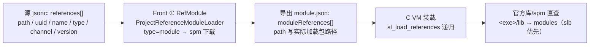

# 标准库与模块系统

> 项目定位：`SLangCore/Lib/` 下的 SL 标准库模块，以及贯穿 Front / C VM / spm 的「模块引用」机制。
> 源码根：`d:/project/lang/SlangAllInOne/SLangCore/Lib/`。
> 编译驱动：`Project/CompileStdlib`（预设 core/std/math/all），见 [08-工具链与打包发布](08-工具链与打包发布.md)。

---

## 1. 标准库模块清单

| 模块 | jsonc 路径 | references | vmDlls（原生库） | 说明 |
|------|-----------|-----------|------------------|------|
| **Core** | `Lib/Core/Core.jsonc` | 空 | 无 | 语言内建与核心运行库：数值类型、String/Array/Type、容器、IO、文本、Data、Coroutine、DllImport 等；含大量系统函数声明 |
| **Std** | `Lib/Std/Std.jsonc` | Core | 无 | 系统与生态：Console/File、Json/Xml/Yaml、net、DB/Sqlite、Cache/Redis、Debug、压缩、Isolate、OS、Server 等；大量 Bridge systemCalls |
| **Math** | `Lib/Math/Math.jsonc` | Core+Std | `math_lib.dll` | 标量/大数/向量矩阵；矩阵运算下沉 C VM（SystemMathMat3Mul 等） |
| **Server** | `Lib/SLang/Server/Server.jsonc` | Core+Std | 无 | HTTP/WebSocket 服务端框架（独立 module，导出名 `SLangServer`） |
| **Render** | `Lib/SLang/Render/SLangRender/Render.jsonc` | Core | `sl_render_lib.dll` | 渲染管线，能力全走 `@DllStaticImport`（详见 [04-CVM 虚拟机](04-CVM虚拟机.md) §6） |
| **Mysql** | `Lib/SLang/Mysql/SLangMysql/MysqlClient.jsonc` | Core | `sl_mysql_lib.dll` | MySQL 客户端（静态绑定） |
| **Tensora** | `Lib/SLang/Tensora/Tensora.jsonc` | Core+Std+Math | 无 | 张量/数值计算（纯 SL 实现） |
| **QT** | `Lib/SLang/QT/QT.jsonc` | Core | `slang_qt.dll` | SLang 绑定 Qt6（单一绑定面 `QTFFI` + core/layout 封装类；stub/Qt 双后端） |
| **WebUI** | `Lib/SLang/WebUI/WebUI.jsonc` | Core | `webui_lib.dll` | 轻量 GUI（webview 绑定） |
| 其他 | `Lib/SLang/Audio/`、`Cuda/`、`Image/SLImage/`、`SimGameEngine/` | 多为 Core | 多数带 dll | 图片/音频/GPU/仿真引擎等 |

**编译顺序**：`Core → Std → Math` 为默认全编顺序（CompileStdlib 的 `all` 预设），每模块起干净子进程隔离 Front 静态状态。

**jsonc 字段语义要点**（权威的解释见 `md/project/project-config-jsonc-guide.md`）：
- 源 jsonc 里依赖字段名为 `references`（导出到 `.module.json` 才叫 `moduleReferences`）。
- `buildVersion`：包版本锚点（各模块独立）。
- `vmDlls`：`{project, name, configuration, platform}`，Front 导出时 MSBuild 编译并拷 DLL。
- `systemCalls`：`cvmFunction` 为空 = 走 Front/纯 SL；非空 = 下沉 C VM（如 Math 矩阵运算）。

---

## 2. 模块引用机制（贯穿三层）

- **Front 侧**（`ProjectReferenceModuleLoader.LoadReferences`）：先 `ProjectModuleDependency.EnsureModuleReferences`（版本检查/下载），加载 `.module.json`/`.slb` 后直接构建 IR 元数据（`isRefModulePreBuilt`，不经 Meta 重建）。`ModuleManager` / `IRMetaModule` 维护 self/core/ref 模块。
- **C VM 侧**（`sl_load_references`，`vm/load/slir_json_module_loader.c:3040`）：4 级探测——绝对路径 → `<dir>/<引用>` → basename 回退 → `<dir>/modules` / `<exe>/modules` / `<exe>/lib`（slb 优先）。发布包内引用写纯名 `Core`/`Std`/`Math` 即可。
- **slb 优先**：`SLModulePackageWriter.ReadPackageForReference` 对 `.slb` 走 SLBReader、`.json` 走 Read，统一归一后剥指令。

---

## 3. 产物与包形态

- 每模块编译产出 `SlangAllInOne/out/export/<模块>/<模块>.module.slb`（主）+ `.module.json`（format=json 时）+ 关联原生 dll。
- `out/export/` 是**全仓唯一产物根**：库 jsonc `export.outputDir` ↔ `PackModulesCommand.exportRoot` ↔ 测试 jsonc references 三方统一。
- 发布包内模块布局（主包四件套之一）见 [08-工具链与打包发布](08-工具链与打包发布.md) §3；模块 slb 平铺 `lib/`，关联 dll 放 `lib/<平台>/`。

---

## 4. 测试与示例消费

- 测试用例集：`SLangCore/test/`（BaseTest / ExpendTest / MathTest / SpecialTest / BenchMark / RenderTest / TensoraTest / FrontDebug / Other）。
- 示例：`SLangCore/samples/`（HelloWorld、Game、GUI、SLang 等）。
- 联合测试宿主 `CSimpleVMTest`（八合一）消费这些用例：Front 编译 → 拷产物入包 → 发布包 `slang run` 执行，见 [08-工具链与打包发布](08-工具链与打包发布.md) §2。

---

## 5. 版本与市场

- 包版本锚点各模块独立（如 Core `0.1.1`、Math `0.2.0`）。
- spm 包管理器（`Project/Spm`，独立 `spm.exe`）支持 install/search/list/outdated/remove/plugin/config；registry 配置见 `md/project/spm-registry.md`。
