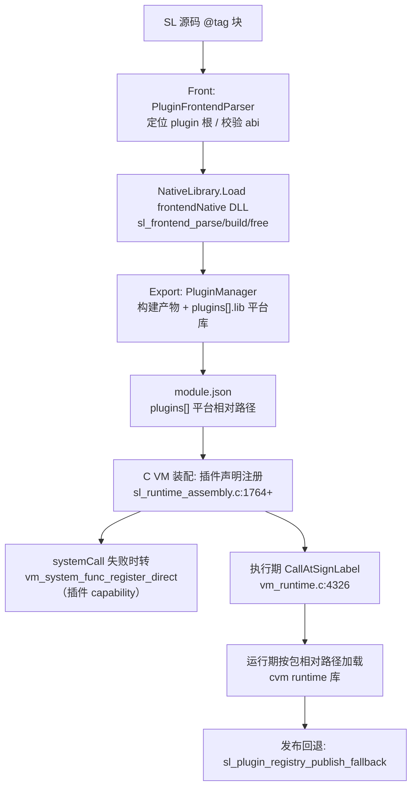

# 插件系统（plugin/）

> 项目定位：让 SL 源码可通过 `@tag{}` 内联块调用其它语言/运行时（C++/C#/Java/Python/JS/TS），或复用外部生态。
> 插件根：`d:/project/lang/plugin/`。权威构建与布局记忆见仓库根 `PROJECTS.md` 与 `md/project/package-layout.md §七`。

---

## 1. 插件清单

| id | 目录 | 作用 | 接入方式 |
|----|------|------|---------|
| csharp_mono | `plugin/csharp_mono/` | 内嵌 Mono 执行 C# 程序集静态方法 | systemCall |
| java_hotspot | `plugin/java_hotspot/` | 内嵌 HotSpot JVM（JNI），Javac 编译静态方法 | signLabel 内联块 |
| echo | `plugin/echo/` | 回声测试插件（systemCall echo 原样回显栈顶） | systemCall（ABI 验证） |
| javascript_quickjs | `plugin/javascript_quickjs/` | 内嵌 QuickJS 执行 JS 函数 | signLabel |
| typescript_nodev8 | `plugin/typescript_nodev8/` | 外接 Node.js V8 执行 TypeScript（node.exe keep-alive + JSON stdio） | signLabel |
| cplus_clang | `plugin/cplus_clang/` | `@cplus_clang` 块经 clang++/MSVC 编译为 SLCpp.dll，FFI 直调 | labelExec trampoline |
| python_cpython | `plugin/python_cpython/` | 内嵌 CPython 执行部署的 `.py` run 函数 | signLabel |

---

## 2. 插件目录结构（dev 树）

```
plugin/<id>/
├── plugin.jsonc              权威清单（abi / entry / capabilities / platform / onUnavailable）
├── frontend/                 前端工程（原生 DLL，sl_frontend_* 三导出；csharp/java 已 C 化）
│   └── src/sl_frontend_abi.h SLPF v3 契约头
├── cvm/                      runtime 工程（vcxproj）+ build-<id>.ps1（一键三产物）
├── slang/                    refModule（<Id>.jsonc + .sl 源码）
└── package/                  三工程产物统一导出位
    ├── <Id>.module.slb       .sl 打包产物（平铺 package\ 根）
    └── <平台>/                windows|linux|macos|ios|android
        ├── cvm_<id>.dll      runtime(cvm) 库
        ├── sl_<id>_frontend.dll  frontend 库
        └── 运行体附属子树（如 mono-2.0-sgen.dll、lib/mono/4.5/…）
```

**三工程**：`frontend`（原生前端）+ `cvm`（runtime）+ `slang`（refModule）。构建入口 `plugin/<id>/cvm/build-<id>.ps1`，vcxproj OutDir 统一 `..\package\windows\`。

---

## 3. plugin.jsonc 关键字段

- `abi`：`{cvm:1, frontend:3}`（frontend 当前 v3）。
- `entry.lib.<平台>`：按平台列出库路径；`entry.prefix`（如 `sl_<id>_`）。
- 六件套 ABI：`sl_<id>_{abi_version,get_info,enter,get_capability,exit,unload}`。
- `capabilities` / `platform` / `onUnavailable`：能力声明与目标平台、不可用时的降级策略。

---

## 4. 前端 ABI（SLPF v3）

- 契约头：`plugin/cplus_clang/frontend/src/sl_frontend_abi.h`（各插件同名）。
- 消息格式：`[Header][结构体][变长][TLV]`。
- 三导出函数：`sl_frontend_parse` / `sl_frontend_build` / `sl_frontend_free`（+ `sl_frontend_abi_version`）。
- Front 侧承载：`PluginFrontendParser`（`ReadManifest` 解析清单、`EnsureNativeLoaded` 用 `NativeLibrary.Load`+`GetExport` 绑定）、`PluginFrontendWorkflow`（五阶段 Prepare→Encode→Invoke→Decode→Complete）、`SlPluginMessageCodec`（编解码）。
- 调用管线时序见 [01-全链路流程](01-全链路流程.md) §5。

---

## 5. 装载与能力注册



- Front 双形态探测（dev `package/<平台>` 优先，发布包平铺 `<平台>` 回退）。
- C VM 插件库按 module.json 包相对路径拼接加载；发布包主路径错位时走 `sl_plugin_registry_publish_fallback`（`vm/plugin/`）。

---

## 6. 发布包内插件布局

发布打包（`csproj PackPlugins`）剥掉 `package/` 层平铺进 `<包根>/plugin/<id>/`：

```
<包根>/plugin/csharp_mono/
├── plugin.jsonc
├── CSharpMono.module.slb
└── windows/…（平台子目录直接挂 plugin\<id>\ 下，无 lib/package 两层）
```

平台目录名 `windows|linux|macos|ios|android` 与主包 `lib/<平台>/`、C VM `sl_platform_dir_name` 同名约定；旧 `os-arch` 目录仅作兼容回退。详见 [08-工具链与打包发布](08-工具链与打包发布.md) §3。
